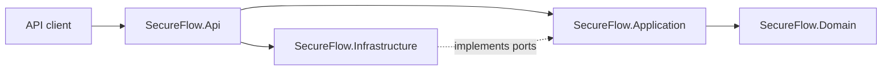
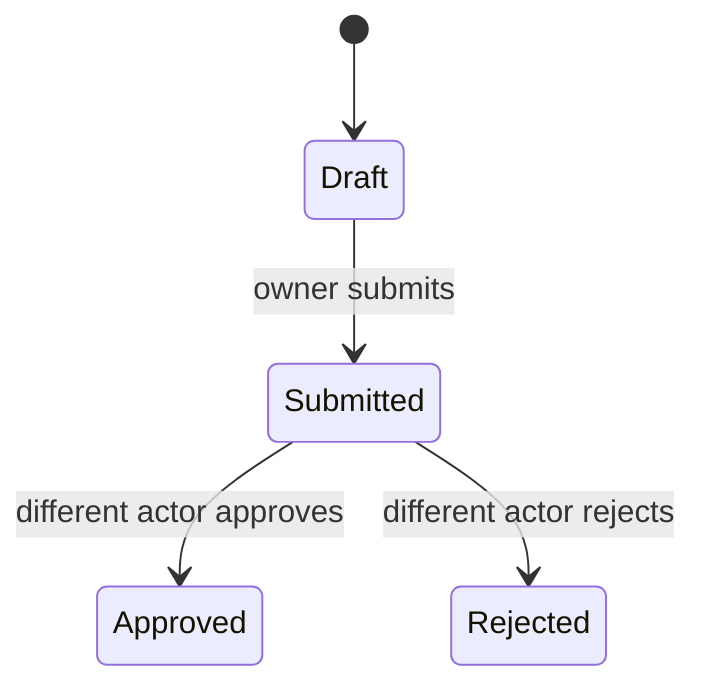

# SecureFlow

[](https://github.com/MatheusDanielPereira/secureflow-dotnet/actions/workflows/ci.yml)
[](https://dotnet.microsoft.com/)
[](LICENSE)

SecureFlow is a clean-room reference API for secure enterprise approval workflows. It demonstrates how to combine explicit domain rules, OAuth 2.0/OIDC authorization, optimistic concurrency, immutable audit events, defensive HTTP controls, and automated tests in .NET 10.

The project was created for portfolio and learning purposes. It contains no proprietary source code, business data, schemas, credentials, screenshots, or documentation.

## What this project demonstrates

- Clean separation between domain, application, infrastructure, and delivery concerns
- JWT bearer authentication with configurable OIDC authority and audience
- Scope-based authorization for read, write, approval, and audit operations
- Separation of duties: request owners cannot approve or reject their own requests
- Optimistic concurrency through ETags and mandatory `If-Match` headers
- Append-only audit events for every workflow transition
- Fixed-window rate limiting partitioned by authenticated subject
- RFC 7807-style problem details without leaking unexpected exception data
- Correlation IDs, defensive response headers, HTTPS redirection, and HSTS
- Request-size limits and secure-by-default configuration placeholders
- Unit and integration tests, coverage collection, dependency auditing, and CI

## Architecture



| Project | Responsibility |
| --- | --- |
| `SecureFlow.Domain` | Workflow state machine and invariants |
| `SecureFlow.Application` | Use cases, ports, paging, auditing orchestration |
| `SecureFlow.Infrastructure` | Thread-safe repository, audit log, system clock |
| `SecureFlow.Api` | HTTP endpoints, authentication, authorization, error handling |
| `SecureFlow.Domain.Tests` | Fast domain-rule tests |
| `SecureFlow.Api.Tests` | End-to-end API behavior and security tests |

See [the architecture notes](docs/architecture.md) for trust boundaries and design decisions.

## Workflow



Every successful transition increments the resource version. A stale client receives `412 Precondition Failed` instead of silently overwriting a newer state.

## API and required scopes

| Method | Route | Scope |
| --- | --- | --- |
| `GET` | `/healthz` | Public |
| `POST` | `/api/work-items` | `workflow.write` |
| `GET` | `/api/work-items` | `workflow.read` |
| `GET` | `/api/work-items/{id}` | `workflow.read` |
| `POST` | `/api/work-items/{id}/submit` | `workflow.write` |
| `POST` | `/api/work-items/{id}/approve` | `workflow.approve` |
| `POST` | `/api/work-items/{id}/reject` | `workflow.approve` |
| `GET` | `/api/audit-events` | `workflow.audit` |

Mutation requests after creation must include the current version:

```http
If-Match: "1"
```

## Run locally

Requirements: [.NET 10 SDK](https://dotnet.microsoft.com/download/dotnet/10.0).

```bash
dotnet restore --use-lock-file
dotnet build --no-restore
dotnet test --no-build
dotnet run --project src/SecureFlow.Api
```

The committed OIDC authority is intentionally non-operational. Configure a real identity provider through environment variables; never commit tenant secrets or tokens.

```bash
Authentication__Authority=https://your-identity-provider.example.com \
Authentication__Audience=secureflow-api \
dotnet run --project src/SecureFlow.Api
```

OpenAPI JSON is exposed at `/openapi/v1.json` only in the Development environment. There is no development authentication bypass; integration tests replace authentication inside the isolated test host.

## Example request

```bash
curl --request POST https://localhost:7001/api/work-items \
  --header "Authorization: Bearer $TOKEN" \
  --header "Content-Type: application/json" \
  --data '{"title":"Quarterly access review","description":"Review privileged access."}'
```

Use the returned `ETag` when submitting the item:

```bash
curl --request POST https://localhost:7001/api/work-items/$WORK_ITEM_ID/submit \
  --header "Authorization: Bearer $TOKEN" \
  --header 'If-Match: "1"'
```

## Docker

```bash
docker build -t secureflow-api .
docker run --rm -p 8080:8080 \
  -e Authentication__Authority=https://your-identity-provider.example.com \
  -e Authentication__Audience=secureflow-api \
  -e AllowedHosts=localhost \
  secureflow-api
```

The current infrastructure adapter stores data in memory so the security and domain behavior can be evaluated without external services. The application ports are intentionally persistence-agnostic; a SQL Server/EF Core adapter can be added without changing the domain or HTTP contract.

## Security

Read [SECURITY.md](SECURITY.md) before reporting a vulnerability. Important production controls such as identity-provider configuration, trusted proxy settings, durable encrypted persistence, centralized audit retention, key rotation, and telemetry must be supplied by the deployment environment.

## License

Licensed under the [MIT License](LICENSE).
